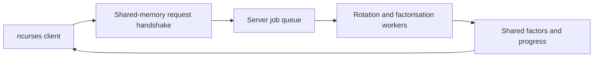

# Concurrent Integer Processing System

A local C client/server application that queues integer requests, generates 32 bit rotations per input and streams prime factors through POSIX shared memory to an interactive terminal client.

Developed in September–October 2023 as university coursework.

## Implementation

- C99, Linux/POSIX APIs, pthreads, named semaphores, ncurses and Make.
- Ten request slots with result handshakes and rotation-completion progress.
- A server queue with newly created worker threads and a configurable cap of 1–320 workers.
- An ncurses client for request entry, result panels and progress display.

This is bounded thread creation. There is no persistent worker pool. Progress counts completed rotations rather than remaining factorisation time.

## Terminal demonstration

The client submits integers 12 and 15. For each request, the server generates all 32 circular bit rotations of its 32-bit representation and finds the prime factors of each rotated value using two worker threads. The red and green panels show streamed factors for request slots 0 and 1; they are not simply the factors of 12 and 15. The left panel tracks completed rotations for each slot; unused slots initially display 100%.

This eight-second excerpt shows request entry and processing at normal speed, rendered from a real Ubuntu WSL terminal recording.

https://github.com/user-attachments/assets/27e5f3c8-561f-49c5-9fb5-d61e939859b5

The run used three local fixes for client test linking, rotation boundaries and overflow-safe factorisation bounds; those fixes are not yet included in this repository.

## Source map

| File | Purpose |
|---|---|
| `app/server/src/server.c` | Requests, worker creation, streamed results and shutdown |
| `app/server/src/numbers.c` | Rotation and trial-division helpers |
| `app/server/src/shared_fields.h` | Shared-memory protocol structures |
| `app/client/src/client.c` | Client processing and coordination |
| `app/client/src/ui.c` | Terminal interface |
| `app/server/tests` | Arithmetic tests and test client |
| `app/client/tests` | Four numeric-input tests |

## Build and verification

The intended environment is Linux with GCC, Make and ncurses/panel/menu/form development libraries. The build entry points are `app/server/Makefile` and `app/client/Makefile`. Their linker flags need verification. The server has no explicit pthread link flag, and the client test target does not link UI dependencies. The dependency-check script only checks one ncurses package.

Build and test instructions have not yet been verified.

## Known limitations

- Rotation by zero or 32 can evaluate an invalid-width shift.
- The trial-division `f * f` condition can overflow. Its standalone helper allocates memory proportional to the input value.
- Workers have no visible join/detach handling or checked thread-creation failure path.
- Queue processing uses busy polling. Shutdown can remove IPC resources while workers remain active.
- Process-local mutexes around progress data do not establish cross-process locking.

## Attribution

Application coursework by Campbell Reid. The third-party greatest test framework retains its embedded notices.
